# 🛒 E-Commerce Inventory & Order Management System


A database-driven system that manages products, customers, orders and inventory for an e-commerce company. The business rules live inside PostgreSQL itself. When an order is placed, the database prices it, applies bulk discounts, checks and deducts stock, logs the inventory change, calculates the order total and updates the customer's loyalty tier. No application code is needed for any of it.

This project was built as a lab for the **"SQL for Professionals"** module of the **AmaliTech Data Engineering Apprenticeship Programme**.

---

## 📑 Table of Contents

1. [Problem Statement](#-problem-statement)
2. [Features](#-features)
3. [Tools and Technologies](#️-tools-and-technologies)
4. [Project Structure](#-project-structure)
5. [Database Schema](#️-database-schema)
6. [Business Rules](#-business-rules)
7. [How the Automation Works](#️-how-the-automation-works)
8. [Getting Started](#-getting-started)
9. [Phase Breakdown](#-phase-breakdown)
10. [Results and Screenshots](#-results-and-screenshots)
11. [SQL Concepts Used](#-sql-concepts-used)
12. [Known Limitations and Future Improvements](#-known-limitations-and-future-improvements)
13. [Author](#-author)

---

## 🎯 Problem Statement

An e-commerce company needs a system that can:

- Store product, customer and order information reliably
- Update stock levels correctly whenever an order is placed
- Keep a full, auditable history of every inventory change
- Identify products that are running low and replenish them
- Provide business insights such as order summaries, customer spending and loyalty tiers
- Stay fast as the number of customers, orders and products grows

---

## ✨ Features

| Feature | How it is implemented |
|---|---|
| Data integrity | Primary keys, foreign keys, `NOT NULL`, `UNIQUE` and `CHECK` constraints |
| Server-side pricing | A `BEFORE INSERT` trigger reads the price from `Products`, so clients cannot set their own price |
| Bulk discounts | 5%, 10% or 15% applied automatically based on quantity |
| Stock validation | Orders larger than the available stock are rejected with a clear error |
| Oversell protection | `SELECT ... FOR UPDATE` locks the product row while stock is checked and deducted |
| Inventory audit trail | Every order deduction and every replenishment is written to `InventoryLogs` |
| Automatic order totals | A trigger keeps `Orders.total_amount` in sync with its order lines |
| Automatic customer tiers | A trigger recalculates Bronze / Silver / Gold whenever a customer's spending changes |
| Replenishment | A stored procedure with a cursor restocks every low-stock product in one call |
| Reporting | Order summaries, low-stock report, spending tiers and discount report |
| Views | Simple, reusable access to order, stock and spending information |
| Performance | Indexes on foreign keys and frequently filtered columns |

---

## 🛠️ Tools and Technologies

| Tool | Purpose in this project |
|---|---|
|  **PostgreSQL** | Relational database that stores the data and runs all the business logic |
|  **PL/pgSQL** | PostgreSQL's procedural language, used for the trigger functions and the replenishment procedure |
|  **pgAdmin 4** | Writing and running SQL in the Query Tool, browsing tables and triggers, generating the ERD |
|  **Visual Studio Code** | Editing the SQL scripts and the README |
|  **Git** | Version control, committing each step of the project |
|  **GitHub** | Hosting the repository and rendering the documentation |
|  **Mermaid** | Drawing the ERD and trigger flowchart directly in this README |
|  **Markdown** | Writing the project documentation |

---

## 📁 Project Structure

```
SQL-For-Data-Professional/
├── README.md
│
├── sql/                                  # Main scripts (project deliverables)
│   ├── 01_schema_setup.sql               # Tables, keys and constraints
│   ├── 02_automation_triggers.sql        # Trigger functions and triggers
│   ├── 03_business_insights.sql          # Reporting queries
│   ├── 04_replenishment_system.sql       # Replenishment stored procedure
│   └── 05_views_and_optimizations.sql    # Views and indexes
│
├── data/
│   └── mock_data.sql                     # Sample customers and products
│
├── tests/                                # Scripts that demonstrate the system works
│   ├── test_order_triggers.sql           # Orders, discounts, totals, tiers, logging
│   ├── test_insufficient_stock.sql       # Rejecting an order with too little stock
│   ├── test_replenishment.sql            # Identifying and restocking low-stock products
│   └── test_views.sql                    # Using the views and checking a query plan
│
└── screenshots/                          # Results captured in pgAdmin
```

The **`sql/`** folder only *defines* things (tables, triggers, procedures, views, indexes). Scripts that insert test data or change stock live in **`tests/`**, so running a main script never changes your data as a side effect.

---

## 🗄️ Database Schema

### Entity Relationship Diagram

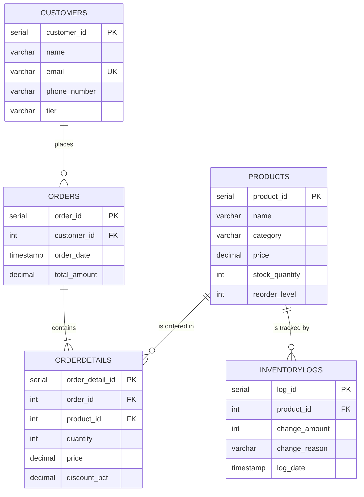

### Tables

| Table | Purpose | Notes |
|---|---|---|
| `Customers` | Customer details and loyalty tier | `email` is unique; `tier` is maintained by a trigger |
| `Products` | Catalogue, price and stock levels | Price, stock and reorder level can never be negative |
| `Orders` | One row per order | `total_amount` is calculated by a trigger |
| `OrderDetails` | One row per product in an order | `price` (after discount) and `discount_pct` are set by a trigger |
| `InventoryLogs` | Audit trail of stock changes | Negative `change_amount` = stock out, positive = stock in |

### Data Integrity Rules

- **Every order belongs to a real customer**, and every order line belongs to a real order and product (`NOT NULL` foreign keys).
- **`CHECK` constraints** reject negative prices, negative stock, negative reorder levels and quantities of zero or less.
- **`ON DELETE RESTRICT`** prevents deleting a customer who has orders or a product that has order or inventory history, so sales and audit records are never lost.
- **`ON DELETE CASCADE`** from `Orders` to `OrderDetails`: deleting an order also deletes its lines, so no orphan lines are left behind.

---

## 📏 Business Rules

### Bulk Discounts

Applied automatically per order line, based on the quantity of that product:

| Quantity | Discount |
|---|---|
| 1 – 9 | 0% |
| 10 – 19 | 5% |
| 20 – 49 | 10% |
| 50 or more | 15% |

### Customer Tiers

Based on a customer's lifetime spending (the sum of all their order totals):

| Tier | Total spent |
|---|---|
| 🥉 Bronze | Under 500 |
| 🥈 Silver | 500 – 1,999 |
| 🥇 Gold | 2,000 and above |

Every customer starts as **Bronze** and moves up automatically as they place orders.

### Low Stock and Replenishment

- A product is **low on stock** when `stock_quantity < reorder_level`.
- Replenishment tops each low-stock product up to **twice its reorder level**. For example, a product with a reorder level of 10 and 7 units in stock receives 13 units and ends at 20. This always brings stock back above the threshold, whatever the product's reorder level.

---

## ⚙️ How the Automation Works

Inserting one row into `OrderDetails` sets off a chain of triggers:

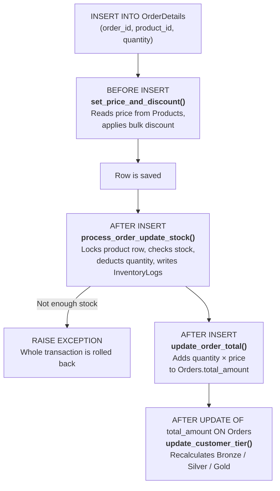

| Trigger | Table | Timing | Function | What it does |
|---|---|---|---|---|
| `trg_before_order_detail_insert` | OrderDetails | BEFORE INSERT | `set_price_and_discount()` | Sets the discounted price and `discount_pct` |
| `trg_after_order_detail_insert` | OrderDetails | AFTER INSERT | `process_order_update_stock()` | Validates and deducts stock, logs the change |
| `trg_update_order_total` | OrderDetails | AFTER INSERT | `update_order_total()` | Updates the order total |
| `trg_update_customer_tier` | Orders | AFTER UPDATE OF total_amount | `update_customer_tier()` | Updates the customer's tier |

Because everything runs inside one transaction, a failure at any step, such as insufficient stock, rolls back **all** of the order's changes. No partial orders, no lost stock.

---

## 🚀 Getting Started

### Prerequisites

- PostgreSQL 12 or newer
- pgAdmin 4 (or the `psql` command-line tool)
- Git

### 1. Clone the repository

```bash
git clone https://github.com/Dushimimanaprince/SQL-For-Data-Professional.git
cd SQL-For-Data-Professional
```

### 2. Create a database

In pgAdmin, right-click **Databases → Create → Database...** and name it `inventory_db`. Or from the terminal:

```bash
createdb inventory_db
```

### 3. Run the scripts in this order

| Step | Script | What it does |
|---|---|---|
| 1 | `sql/01_schema_setup.sql` | Creates the tables |
| 2 | `data/mock_data.sql` | Inserts 5 customers and 3 products |
| 3 | `sql/02_automation_triggers.sql` | Creates the trigger functions and triggers |
| 4 | `tests/test_order_triggers.sql` | Places test orders and shows the results |
| 5 | `tests/test_insufficient_stock.sql` | Shows an order being rejected |
| 6 | `sql/03_business_insights.sql` | Runs the reports |
| 7 | `sql/04_replenishment_system.sql` | Creates the replenishment procedure |
| 8 | `tests/test_replenishment.sql` | Restocks low-stock products |
| 9 | `sql/05_views_and_optimizations.sql` | Creates the views and indexes |
| 10 | `tests/test_views.sql` | Uses the views and checks a query plan |

### Running in pgAdmin

- Open each file in the **Query Tool** (`File → Open`).
- Pressing **F5** with nothing highlighted runs the whole file, but the **Data Output** tab only shows the result of the **last** query.
- To see a specific result, **highlight that query and press F5**.
- In `tests/test_order_triggers.sql`, run **Part A** (the inserts) **only once**, then run each query in **Part B** separately. Running Part A again places duplicate orders.
- `RAISE NOTICE` messages and errors appear in the **Messages** tab.
- If a query fails inside a transaction, run `ROLLBACK;` before doing anything else.

### Resetting the data

To start again with clean data, while keeping the tables, triggers, procedures and views:

```sql
TRUNCATE TABLE InventoryLogs, OrderDetails, Orders, Products, Customers
RESTART IDENTITY CASCADE;
```

Then run `data/mock_data.sql` again and continue from step 4.

---

## 🧩 Phase Breakdown

### Phase 1: Database Design and Schema (`sql/01_schema_setup.sql`)

**Goal:** a reliable relational structure that rejects bad data at the point of entry.

- Five related tables linked by primary and foreign keys.
- `UNIQUE` on customer email, `NOT NULL` on required fields, `DEFAULT` values for tier, dates and totals.
- `CHECK` constraints on price, stock, reorder level and quantity.
- Deletion rules chosen deliberately: `RESTRICT` to protect history and `CASCADE` to remove order lines with their order.

### Phase 2: Order Placement and Inventory Tracking (`sql/02_automation_triggers.sql`)

**Goal:** process orders correctly and record every stock change.

- **Orders with multiple products:** one `Orders` row plus several `OrderDetails` rows, run inside a single transaction (`BEGIN ... COMMIT`).
- **Server-side pricing:** the price is always copied from `Products`, never supplied by the client.
- **Stock deduction with validation:** if the requested quantity is larger than the stock, the trigger raises an exception and the order is cancelled.
- **Row locking:** `SELECT ... FOR UPDATE` makes simultaneous orders for the same product wait their turn, so stock can't be oversold.
- **Inventory logging:** every deduction is written to `InventoryLogs` with the product, the amount, the reason and the time.

Example of placing an order with two products:

```sql
BEGIN;
INSERT INTO Orders (customer_id) VALUES (1);
INSERT INTO OrderDetails (order_id, product_id, quantity)
VALUES (currval('orders_order_id_seq'), 1, 1),
       (currval('orders_order_id_seq'), 3, 2);
COMMIT;
```

`currval('orders_order_id_seq')` returns the ID of the order just created, so no IDs need to be hardcoded.

### Phase 3: Monitoring and Reporting (`sql/03_business_insights.sql`)

**Goal:** turn raw transactions into useful business information.

1. **Order summaries:** customer, order date, total amount and number of items per order (`JOIN` + `GROUP BY` + `SUM`).
2. **Low-stock report:** products below their reorder level, flagged as *Out of Stock* or *Reorder Needed* (`CASE`).
3. **Customer spending and tiers:** lifetime spending per customer with their tier. `LEFT JOIN` and `COALESCE` make sure customers with no orders still appear, with 0 spent.
4. **Bulk discount report:** original price, discounted price and total discount for every discounted order line.

### Phase 4: Stock Replenishment and Automation (`sql/04_replenishment_system.sql`)

**Goal:** restock automatically and remove manual work.

- **`replenish_low_stock()`** is a stored procedure that:
  1. Opens a **cursor** over all products where `stock_quantity < reorder_level`
  2. Loops through them with `FOR ... LOOP`
  3. Calculates each product's restock amount (`reorder_level × 2 − stock_quantity`)
  4. Updates the stock and writes an `InventoryLogs` entry
  5. Reports each restock with `RAISE NOTICE`
- Calling it when nothing is low does nothing, so it is safe to run at any time.

Automated with triggers (from Phase 2): stock updates after an order, order total calculation, and customer tier categorization.

```sql
CALL replenish_low_stock();
```

### Phase 5: Views and Optimization (`sql/05_views_and_optimizations.sql`)

**Goal:** simplify data access and keep queries fast as data grows.

**Views**

| View | Shows |
|---|---|
| `vw_order_summaries` | Customer name, order date, total amount and number of items per order |
| `vw_low_stock_alerts` | Products below their reorder level |
| `vw_customer_spending` | Number of orders, total spent and tier per customer |

```sql
SELECT * FROM vw_low_stock_alerts;
```

**Indexes**

PostgreSQL automatically indexes primary keys and `UNIQUE` columns, but **not foreign keys**. Without indexes, every join on a foreign key scans the whole table.

| Index | Speeds up |
|---|---|
| `idx_orders_customer_id` | Joining orders to customers, finding a customer's orders |
| `idx_orderdetails_order_id` | Joining order lines to orders |
| `idx_orderdetails_product_id` | Joining order lines to products, sales per product |
| `idx_inventorylogs_product` | Inventory history per product, sorted by date |
| `idx_orders_order_date` | Reports filtered by date range |

On the small sample data, `EXPLAIN ANALYZE` still shows a **Seq Scan**. This is expected: reading a handful of rows directly is faster than using an index, so PostgreSQL skips it. The indexes take effect once the tables hold thousands of rows.

---

## 📸 Results and Screenshots

All results below come from running the scripts in order on the sample data.

### Expected Results

| Check | Result |
|---|---|
| Order 1 (MacBook ×1 + Keyboard ×2) | Total **2,740.00** |
| Order 2 (Keyboard ×10, 5% off) | Price 114.00 per unit, total **1,140.00** |
| Order 3 (Pixel ×1) | Total **350.00** |
| Customer tiers | Prince **Gold**, Alice **Silver**, Danny **Bronze**, others **Bronze** |
| Stock after orders | MacBook 14, Pixel 7, Keyboard 18 |
| Order for 50 Pixels | **Rejected**: only 7 available, nothing saved |
| Low-stock report | Google Pixel 4a (7 in stock, reorder level 10) |
| After replenishment | Pixel restocked by 13 → **20** |
| Inventory log | 4 order deductions + 1 replenishment |

### Schema

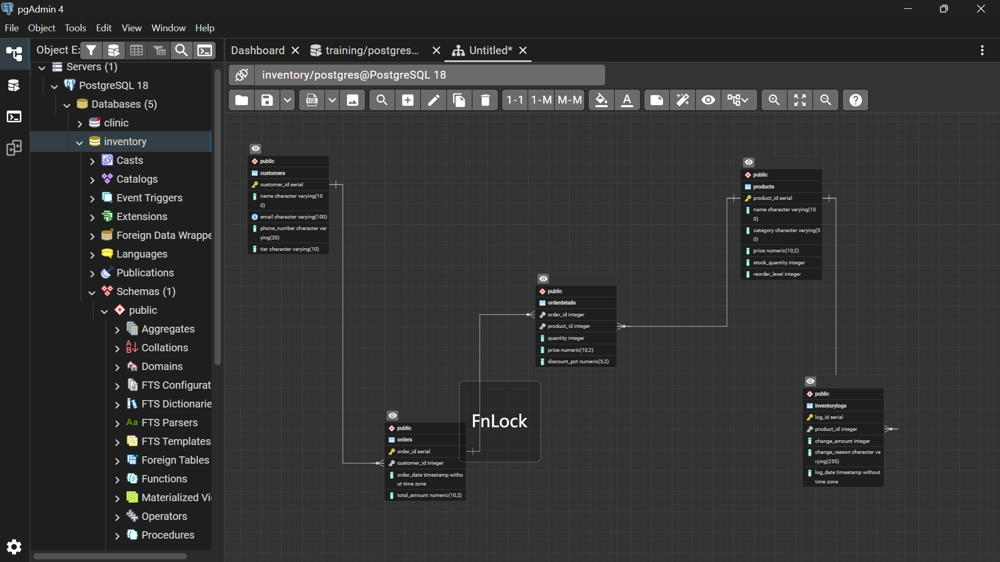

### Triggers Created

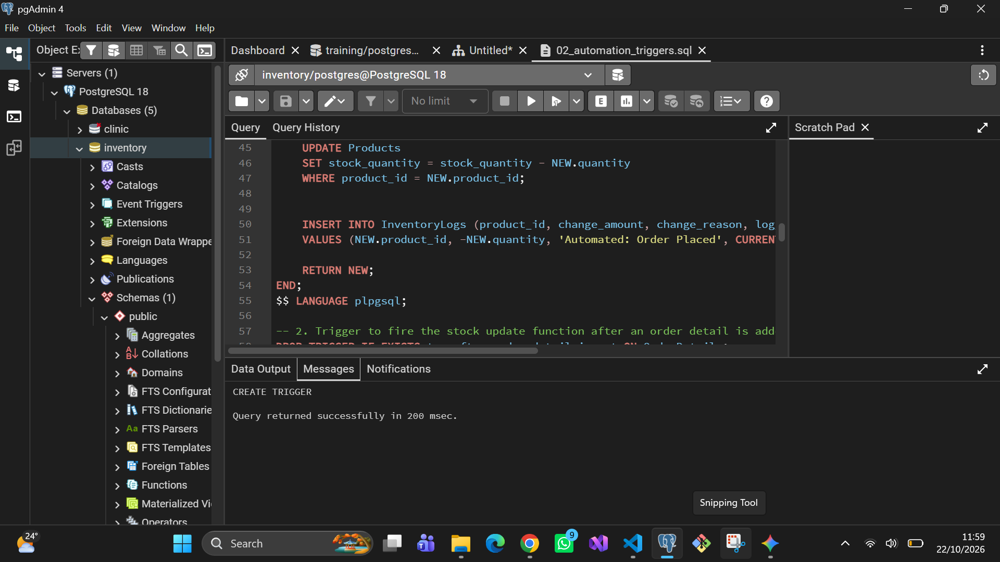

### Order Lines: Prices and Bulk Discount

The keyboard order of 10 units was priced at 114.00 instead of 120.00, a 5% bulk discount applied by the trigger.

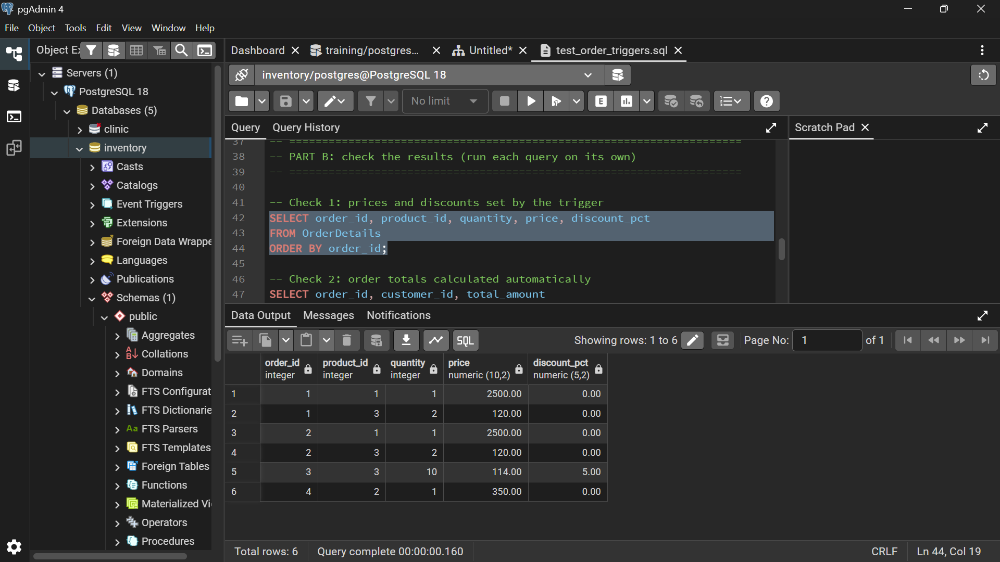

### Order Totals Calculated Automatically

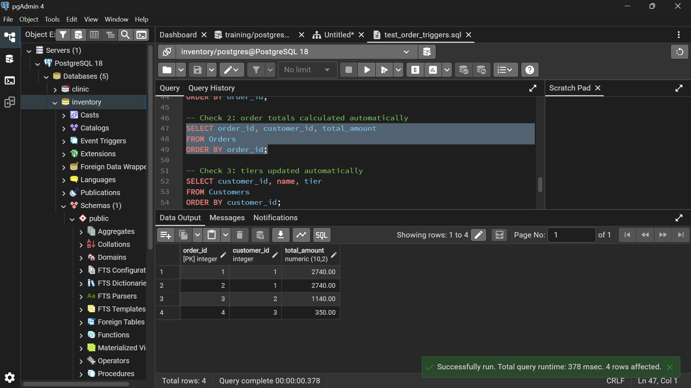

### Customer Tiers Updated Automatically

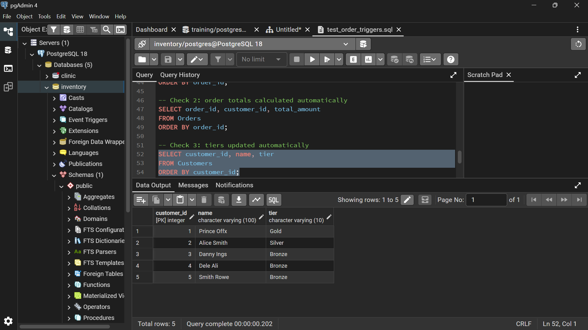

### Insufficient Stock Rejected

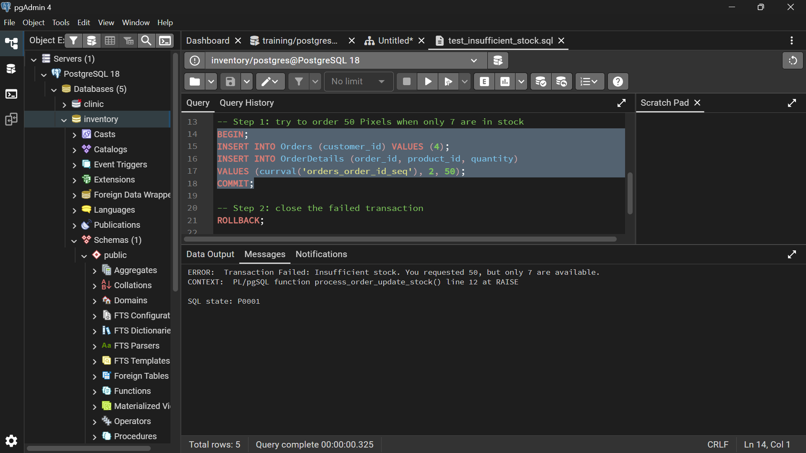

### Low-Stock Report

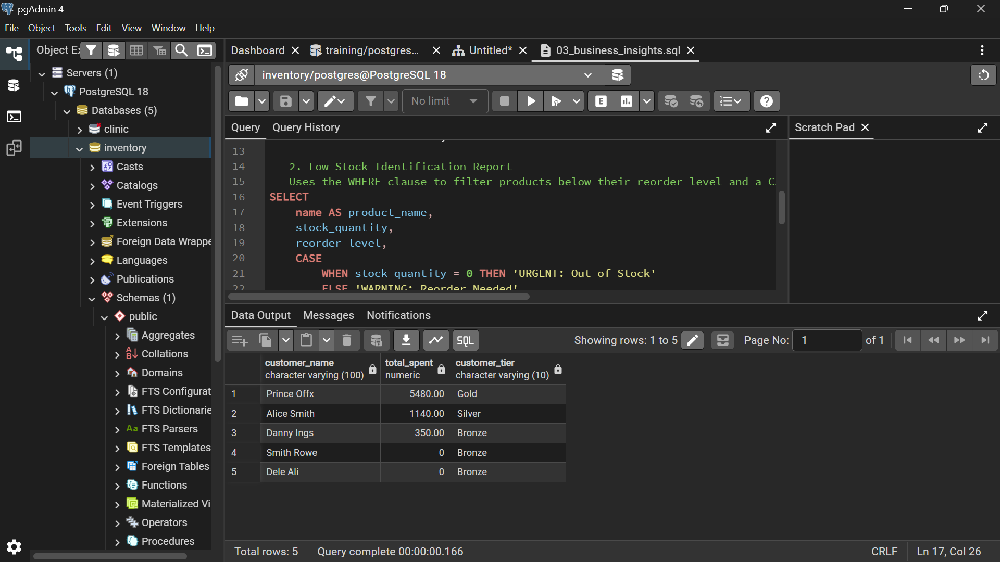

### Replenishment

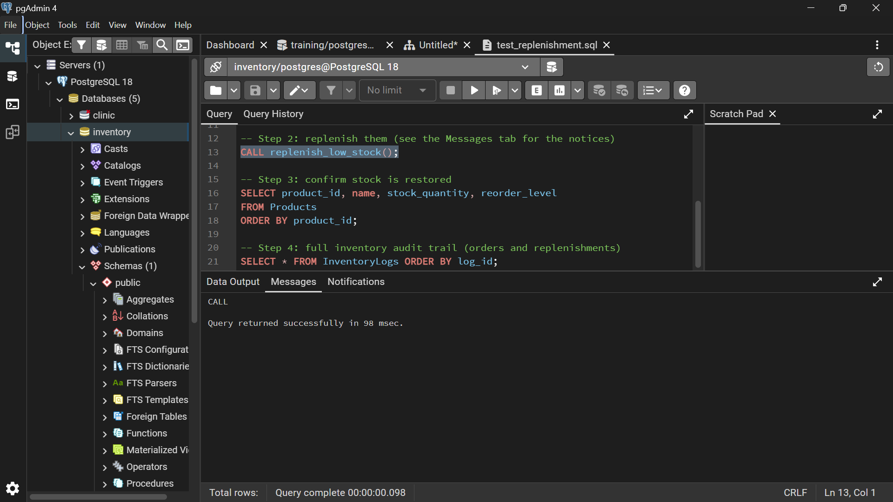

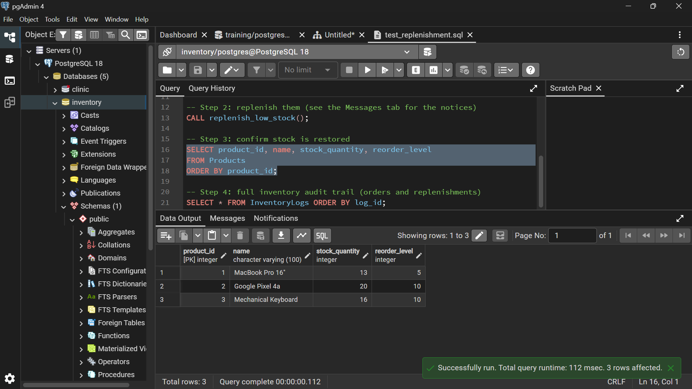

### Inventory Audit Trail

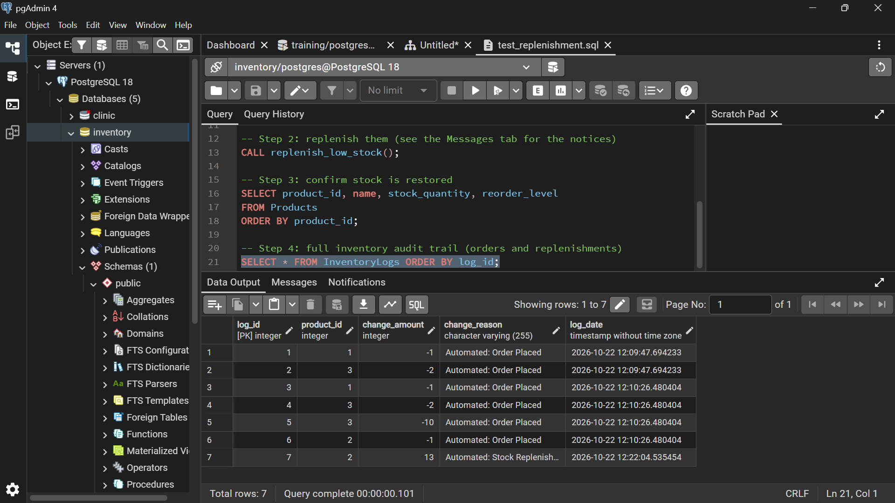

### Customer Spending View

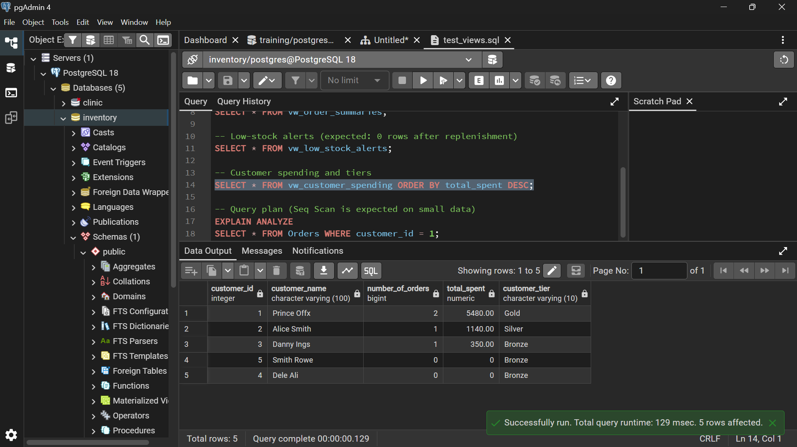

---

## 🧠 SQL Concepts Used

| Concept | Where |
|---|---|
| Primary keys, foreign keys, `UNIQUE`, `NOT NULL`, `CHECK`, `DEFAULT` | `01_schema_setup.sql` |
| `ON DELETE CASCADE` / `ON DELETE RESTRICT` | `01_schema_setup.sql` |
| PL/pgSQL functions | `02_automation_triggers.sql` |
| `BEFORE` and `AFTER` row-level triggers | `02_automation_triggers.sql` |
| `RAISE EXCEPTION` for business-rule validation | `02_automation_triggers.sql` |
| Row locking with `SELECT ... FOR UPDATE` | `02_automation_triggers.sql` |
| Transactions (`BEGIN`, `COMMIT`, `ROLLBACK`) | `tests/` |
| Sequences (`currval`) | `tests/test_order_triggers.sql` |
| `JOIN`, `LEFT JOIN`, `GROUP BY`, aggregates | `03_business_insights.sql` |
| `CASE` and `COALESCE` | `03_business_insights.sql` |
| Stored procedures, cursors, `FOR ... LOOP`, `RAISE NOTICE` | `04_replenishment_system.sql` |
| Views | `05_views_and_optimizations.sql` |
| Indexes and `EXPLAIN ANALYZE` | `05_views_and_optimizations.sql`, `tests/test_views.sql` |

---

## 🔭 Known Limitations and Future Improvements

- **Manual stock updates are not logged.** Orders and replenishments write to `InventoryLogs`, but a direct `UPDATE Products SET stock_quantity = ...` does not. Moving the logging into a trigger on `Products` would capture every change.
- **Order lines are insert-only.** Updating or deleting an `OrderDetails` row does not adjust stock or the order total. Order cancellation and editing could be added with `UPDATE` and `DELETE` triggers.
- **Fixed business rules.** Discount and tier thresholds are written inside the trigger functions. Storing them in a settings table would let the business change them without editing code.
- **Order ID gaps.** A rejected order still uses up an ID, because PostgreSQL sequences do not roll back. This is normal behaviour and does not affect data correctness.
- **Possible extensions:** a `place_order()` procedure that takes product and quantity arrays in one call, supplier and purchase-order tables for replenishment, and scheduled replenishment with `pg_cron`.

---

## 👨‍💻 Author

**Prince Dushimimana**
Data Engineering Apprentice @ AmaliTech
Software Engineering Student

---

*Debugging: being the detective in a crime movie where you are also the murderer. 🕵️*
